# Innerloop and outerloop

Issues are the only external work input. Installation configures capabilities;
it cannot inject a candidate, validation result, merge or promotion. This map
separates intended responsibilities from currently installed functionality.

```mermaid
flowchart LR
    I[GitHub issue] --> A[Authenticated intake and admission]
    A --> O[Orchestrator]
    O --> W[Innerloop: isolated SCC and local checks]
    W --> C[Immutable unvalidated candidate]
    C --> V[Outerloop: independent verification]
    V --> P[PR and current review/check gates]
    P --> M[Authorized merge]
    M --> B[Konflux build and signed provenance]
    B --> G[Conforma release policy]
    G --> D[Same digest deployment and user checks]
    D --> R[Observe or bounded rollback]
```

| Boundary | Own images | Responsibility and authority |
| --- | --- | --- |
| Innerloop | `worker`, `model-mailbox` | Coordinate isolated SCC generation, workspace tools and local checks. The executor receives no publishing, database or deployment credentials. Controller credentials remain outside its Pod. |
| Outerloop | `artifact-builder`, `release-manager` | Deterministic artifact assembly/publication and evidence-gated release coordination. Konflux/Tekton, Chains and Conforma are external dependencies. Independent verifier/deployer roles are defined but not yet installed components. |
| Shared | `intake`, `admission-controller`, `orchestrator`, `relay`, `migrator` | Issue provenance, eligibility, bounded state transitions, signed durable transport and installation-only schema/role setup. PostgreSQL is external infrastructure. |

There are nine own image definitions. Image inventory is not the count of
installed Deployments: maintenance/shadow installs six runtime services plus
PostgreSQL and a short-lived migrator Job. Executors, mailbox and artifact build
workloads are currently exercised by isolated component fixtures.

## Graduation evidence

| Transition | Current evidence | Required before a live E2E claim |
| --- | --- | --- |
| Issue → admission → plan | Installed signed shadow flow with real Homedir issues | Approved non-shadow profile and current eligibility |
| Plan → generated candidate | [Reusable bounded controller](security/innerloop-controller.md), isolated SCC/gVisor/PostgreSQL fixtures | Operational scheduler/inbox, scoped grants, containerized model gateway and failure recovery |
| Candidate → verified PR | Candidate delta reconstruction; authority contracts | Independent test/scope verification, signed handoff, idempotent publisher and real PR evidence |
| PR → merge | Policy requirements documented | Current head/base, resolved threads/change requests/check failures and repository-required approvals |
| Merge → trusted image | Real pinned Homedir build, Chains signature/identity checks and runtime smoke | Component-triggered merged-source build plus enterprise Conforma release policy |
| Image → production-test | Isolated runtime smoke only | Same-digest deployment to `ai-sdlc-production`, user journeys, readiness and rollback through runtime components |

Generation-local tests provide feedback; outerloop validation independently
checks the exact captured candidate under a trusted recipe. Model claims,
worker exit zero, signatures alone and HTTP 200 do not establish software
acceptance. Every boundary rechecks current authority and artifact identity.

The [enterprise pilot](enterprise-pilot.md) tracks the remaining delivery work.
The public Homedir production environment is outside the local test scope.
