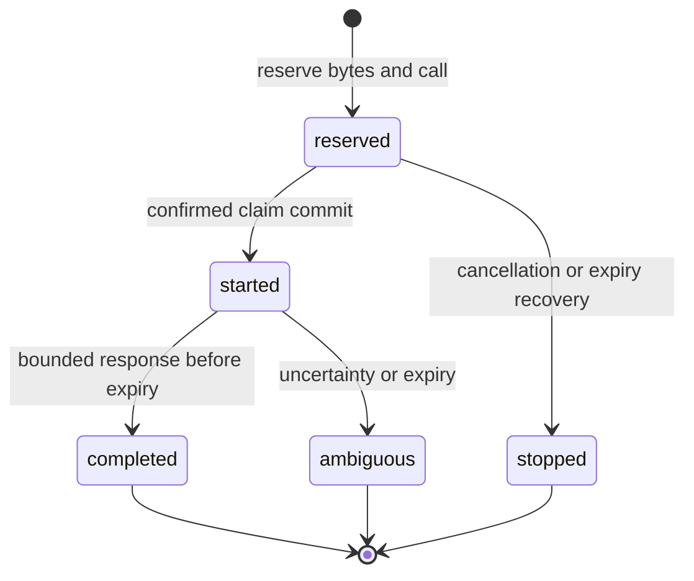

# Durable model-call reservations: hidden controller prerequisite

Issue #463 adds a PostgreSQL ledger for a future trusted model controller.
It is not a provider, an authorization endpoint, a new runtime service, or a
completed autonomous flow. No current component calls it, and none of the eight
operational database roles can access its tables. The executor and
[offline mailbox](offline-model-mailbox.md) receive no database credentials.

## Immutable scope and finite limits

One `model_budgets` row belongs to an existing running work item and binds its
repository, source commit, policy digest and exact model identifier. Policy is
insert-only through this API. Recreating it cannot reset counters. Each
`model_allocations` row binds one attempt number to one Pod UID. Another Pod
cannot take over that attempt, and a new attempt consumes the same parent budget.
An allocation must fit inside its parent's limits and expiration.

| Scope | Calls | Request bytes reserved | Response bytes reserved | Lifetime ceiling |
| --- | ---: | ---: | ---: | ---: |
| Work item | 128 | 16 MiB | 32 MiB | 24 hours |
| Allocation | 32 | 4 MiB | 8 MiB | 1 hour |
| Individual call | 1 | 128 KiB | 256 KiB | 60 seconds |

These are implementation ceilings; reviewed policy should set lower limits as
appropriate. Every database operation has a ten-second context deadline. The
mailbox has its own earlier deadline, which a future controller must also honor.

Reservation validates the mailbox's strict top-level request schema and compares
its actual `model` field with policy. It hashes the exact request bytes and
charges their actual size. Nested messages and tools remain untrusted provider
input; this is not validation of tool authority or a complete provider schema.
No executor-provided byte count, destination, claimed budget or digest is trusted.

The reservation charges one call and the allocation's **maximum response size**
up front. Completion, failure, timeout and cancellation do not refund it. Parent
and allocation counters update in the same transaction. Different allocations
cannot spend the same remaining parent budget concurrently. There is at most one
pending call per allocation, with consecutive sequence numbers. An exact repeated
reservation returns existing metadata; changed bytes, identity or model stop the
parent budget. No API resumes a stopped budget.

## Dispatch and uncertain outcomes



All mutations lock parent budget, allocation and call in that order. Expiration
uses PostgreSQL `clock_timestamp()` after the shared locks, rather than the
transaction's start time. A successful `ClaimModelCall` returns `Invoke=true`
only to the process whose new `reserved -> started` transaction committed.
Existing `started` or terminal state never authorizes another dispatch. Errors,
including an uncertain commit acknowledgement, return no invocation grant.

A future controller must disable implicit provider retries, verify the exact
reserved body immediately before dispatch, honor both call and mailbox deadlines,
and reconcile any uncertain outcome. Reading `started` after a restart does not
prove whether the provider received the request. Recovery marks it ambiguous and
stops the parent budget; it never tries again automatically. Expiry recovery
examines at most 100 calls per invocation, serializing with completion. Every
reservation and claim also checks for expired pending calls across the parent
budget under its lock. A different attempt cannot dispatch while an expired call
awaits the next recovery sweep.

Completion records only response byte count, SHA-256 and supported HTTP status.
It cannot reopen stopped state. Exact repeated completion is idempotent; conflicting
completion metadata stops the parent budget. If a response is lost after metadata
was committed, **the response body cannot be recovered from this ledger**. Neither
reconstructing it nor making another provider call is an automatic replay policy.

## Authority and remaining boundaries

The ledger is a persistence primitive, not permission to execute a work item.
Provisioning and dispatch still require a reviewed controller identity, current
signed execution authority, immutable Pod/image/template checks, fixed provider
configuration, credential separation, output validation and a cancellation
protocol. Merely having a running work-item row is not sufficient authorization.
There is intentionally no HTTP route, new role grant, provider client or live
Job integration in this change. Migrations are applied by the dedicated migrator;
new component images require migration 0004 before becoming ready.

Calls and bytes are not tokens or money. Provider billing, account-wide and
installation-wide budgets, concurrency across work items, retention/archival and
verified usage reporting remain separate work. Unknown cost remains unknown.
Database owners remain trusted: direct privileged SQL can change policy or
counters. Operational roles have neither table nor column grants to this ledger.

## Real validation

From `runtime/k8s`, set `AI_SDLC_TEST_DATABASE_URL` to a disposable PostgreSQL
instance and run:

```sh
go test -count=1 ./internal/store -run TestModel -v
```

The tests create fixture work items, never advance live issues, and cover:

- Concurrent identical reservations, shared budgets across attempts, and a single
  winning claim among concurrent controllers.
- A separate connection observing `started`, exact replay, changed request/model,
  replaced Pod, skipped sequence, pending-call and byte-limit rejection.
- Expiration while blocked on a row lock, completion/recovery races, response
  overflow, cancellation and no refund after an uncertain outcome.
- A real PostgreSQL wire proxy that drops the **COMMIT acknowledgement after the
  server committed**; no invocation grant escapes, and a fresh connection cannot
  claim the same call again. This test requires the isolated fixture's
  `sslmode=disable`; no production connection is intercepted.
- Actual access denial for all eight current runtime roles after role provisioning.

This evidence validates the isolated persistence component. It does not prove a
provider call, SCC-generated improvement, release provenance, deployment or
issue-to-production E2E delivery.
